<p align="center">
  
</p>

<h1 align="center">Vacanto</h1>

<p align="center"><strong>Tell it the job you want. Get a Telegram message when it's posted.</strong></p>

<p align="center">A Windows desktop app that keeps an eye on job boards and company careers pages, so you don't have to.</p>

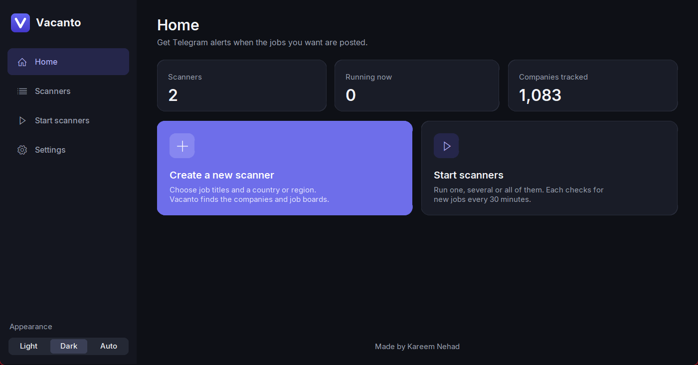

## Why Vacanto?

Good roles often appear on a company's own careers page, in one of several job boards, or in a LinkedIn post, and it's hard to check them all every day. Vacanto checks them for you and only messages you about new jobs that match what you asked for.

- **Finds the companies for you.** Pick a country or region, and it builds the list of companies to watch.
- **Looks in many places.** Job boards, careers pages and LinkedIn posts are all covered by one scanner.
- **Stays on topic.** You choose the titles to look for and the words to rule out.
- **Doesn't repeat itself.** A job listed in three places reaches you once.
- **Needs no setup.** It's a single file that you open, with nothing to install.

## How it works

1. **Create a scanner.** Give it the job titles you want and a country or region.
2. **Let it find companies,** or add your own list.
3. **Press start.** Each scanner looks for new jobs every 30 minutes.
4. **Get alerts on Telegram,** with the job's title, company, location and link.

## A look around

### Create a scanner

Enter a name, job titles and a location. A title like "Flutter Developer" also finds variations such as "Senior Flutter Engineer". You can choose from 86 countries and 16 regions, including the Middle East, North America, Western Europe and EMEA.

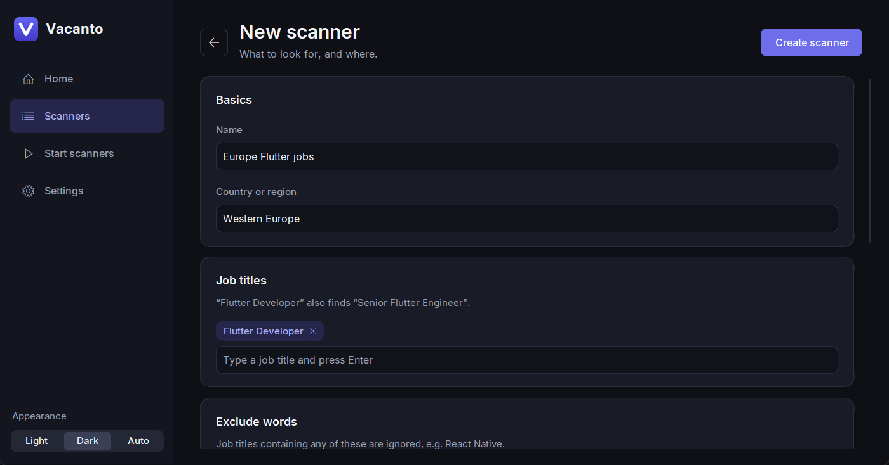

### Keep alerts relevant

Exclude words filter out the jobs you don't want. If you're after Flutter roles, for example, you can rule out "React Native" and "QA".

You can also let Vacanto find companies automatically, or add them all yourself.

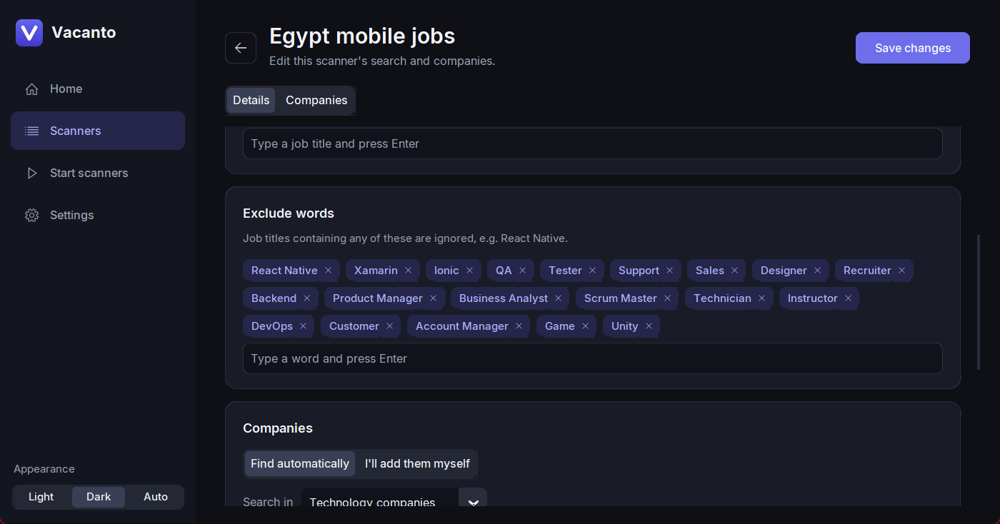

### Choose where to look

Vacanto shows the job boards that cover your location, and you can turn each one on or off. They include LinkedIn Jobs, LinkedIn posts, Workable, Built In, Bayt, GulfTalent and Wuzzuf.

On the first scan, Vacanto normally just notes what's already posted, so you only hear about jobs that appear afterwards. If you'd like to see the existing ones too, there's a switch for that.

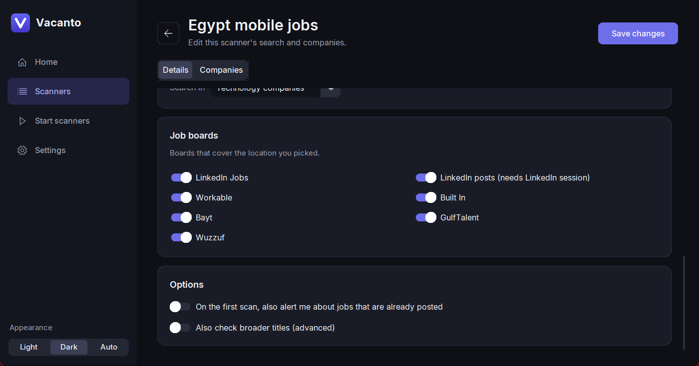

### Manage your companies

See every company a scanner watches and how it's being checked. You can filter the list, add a company, or delete the ones you don't want. Companies you delete stay deleted, even if you search again.

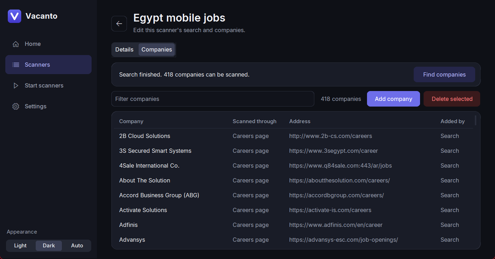

### Run one, some or all

Start and stop scanners individually or all at once. Each one shows its last scan, its next scan and how many alerts it has sent, and the activity log shows what's happening.

Scanners run while the app is open, and they stop when you close it.

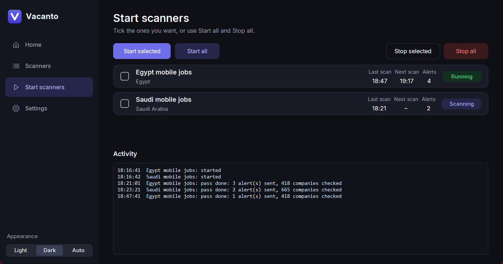

### All your scanners in one place

Keep a separate scanner for each search, then edit or delete them whenever you like. If you change a scanner's location, Vacanto searches for companies there and keeps the ones you added yourself.

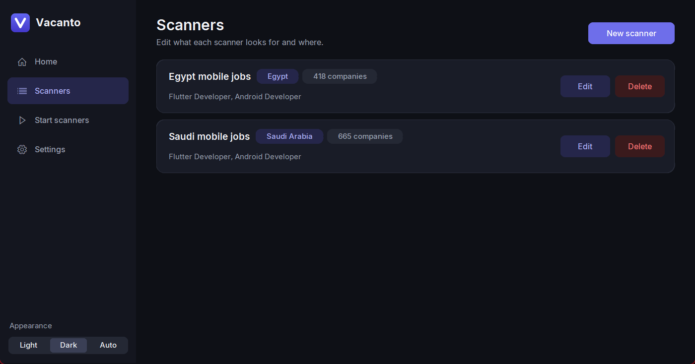

### Settings

Enter your Telegram username and send yourself a test message. This is also where you can add a LinkedIn session, with step-by-step instructions built in.

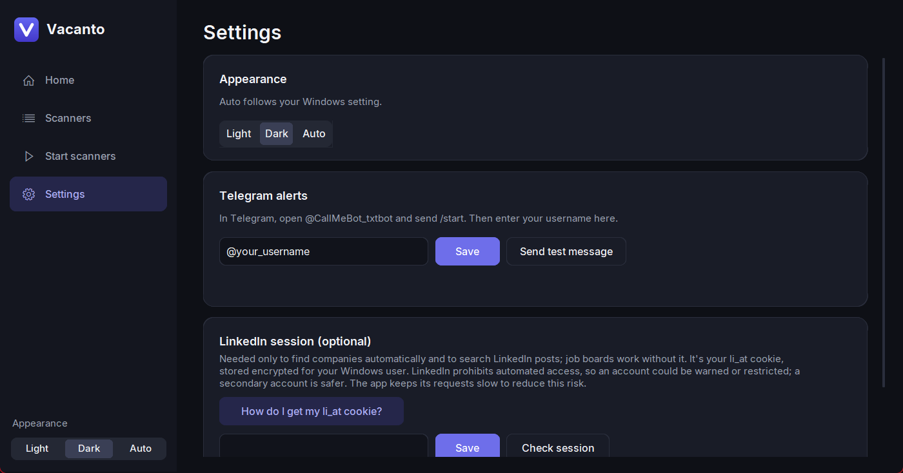

## Light or dark

Choose Light or Dark, or pick Auto to follow your Windows setting.

| | |
|:---:|:---:|
| 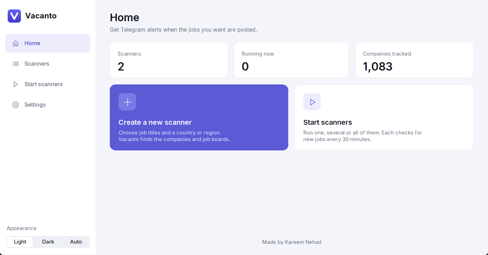 | 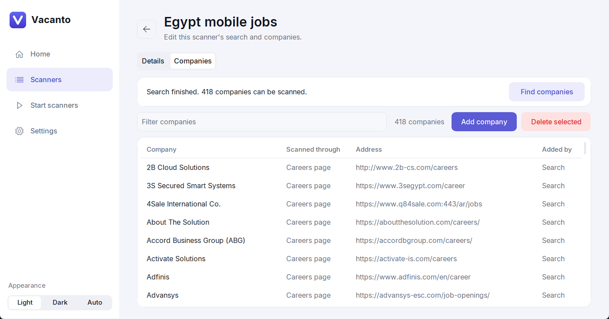 |
| 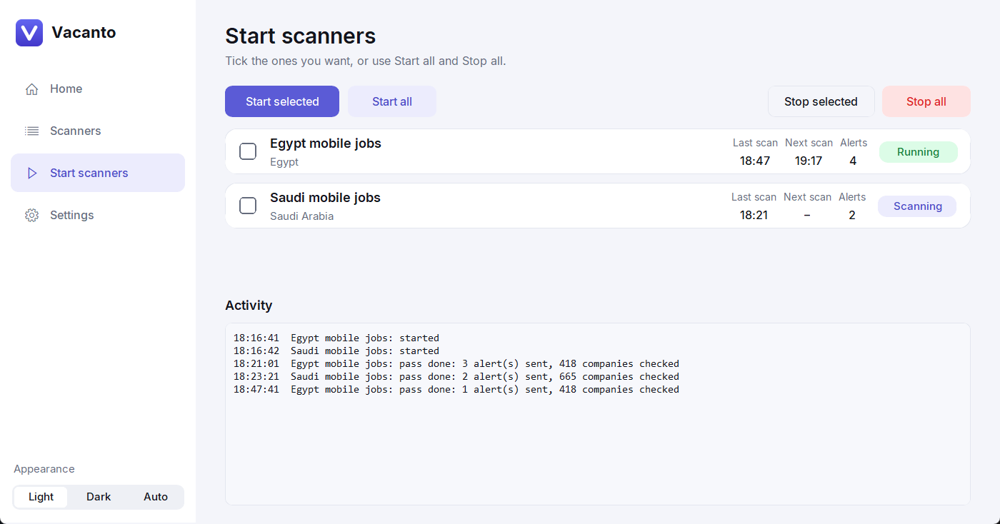 | 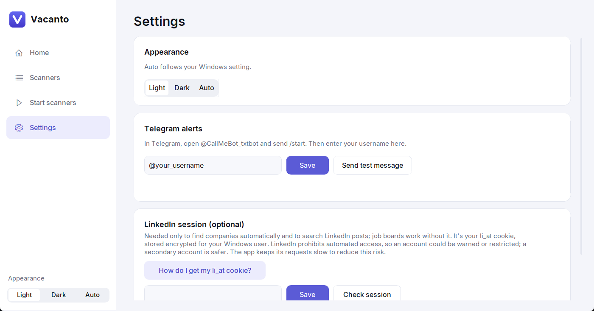 |

## What an alert looks like

Each new job arrives as a short Telegram message. Here's an example:

```text
🔎 Egypt mobile jobs · Wuzzuf
Senior Flutter Developer @ Example Company
Cairo, Egypt
https://example.com/jobs/senior-flutter-developer
```

## Getting started

1. Open `Vacanto.exe`. Windows may show a warning the first time, because the app isn't from a registered publisher.
2. In Telegram, open **@CallMeBot_txtbot** and send `/start`.
3. In Vacanto, go to **Settings**, enter your Telegram username and send a test message.
4. Create your first scanner and press start.

## About LinkedIn

A LinkedIn session is optional. You only need it to find companies automatically and to search LinkedIn posts. Without it, you can still use the other job boards and add companies yourself.

Keep these points in mind if you add one:

- **There's a risk to the account.** LinkedIn prohibits automated access, so an account could be warned or restricted. Vacanto keeps its requests slow to reduce this risk, but a secondary account is safer.
- **Treat the session like a password.** Anyone who has it can use that LinkedIn account without logging in, so never send it to anyone.

## Your data

Your scanners and settings are kept on your own PC, and your LinkedIn session is stored encrypted for your Windows user. Alerts are sent through the CallMeBot service, which delivers them to your Telegram.

---

<p align="center">Made by Kareem Nehad</p>

<p align="center"><sub>Screenshots use a sample setup. The scanner status, activity log and alert shown are examples.</sub></p>
